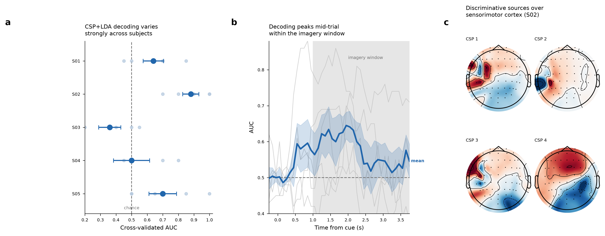

# EEG Motor-Imagery Decoding

A minimal, reproducible brain–computer interface (BCI) decoding pipeline that
classifies **left-fist vs. right-fist motor imagery** from scalp EEG, using the
field-standard **Common Spatial Patterns (CSP) + Linear Discriminant Analysis
(LDA)** approach in [MNE-Python](https://mne.tools).



## Dataset

[PhysioNet EEG Motor Movement/Imagery Database](https://physionet.org/content/eegmmidb/1.0.0/)
(`eegmmidb`) — 64-channel EEG at 160 Hz. This pipeline uses runs 4, 8, and 12
(imagined opening/closing of the left or right fist). Data is downloaded
automatically on first run via MNE's `eegbci` loader.

## Method

| Stage | Detail |
|-------|--------|
| Band-pass | 7–30 Hz (mu + beta sensorimotor rhythm) |
| Epoch | 1–4 s after cue (motor-imagery window) |
| Spatial filter | Common Spatial Patterns, 6 components, Ledoit–Wolf shrinkage |
| Classifier | Linear Discriminant Analysis |
| Validation | 5-fold stratified cross-validation, per subject |

## Results (committed run: 5 subjects)

| Subject | AUC | Accuracy |
|---------|-----|----------|
| S01 | 0.64 | 0.53 |
| S02 | **0.88** | **0.91** |
| S03 | 0.36 | 0.38 |
| S04 | 0.50 | 0.51 |
| S05 | 0.70 | 0.67 |
| **Mean** | **0.62** | **0.60** |

The wide spread across subjects is the expected finding, not noise: some
participants produce cleanly separable motor-imagery patterns (S02) while others
sit near chance ("BCI illiteracy"), a well-documented phenomenon in the field.
An earlier run reported a 500-permutation test for S02 (AUC = 0.95, p = 0.002). The current script does not contain a permutation test, so that figure is not reproducible from this repository as it stands.

The figure panels: **(a)** per-subject cross-validated AUC; **(b)** sliding-window
CSP decoding over time, peaking mid-trial within the imagery window; **(c)** CSP
spatial patterns for the best subject, localising discriminative activity over
left/right sensorimotor cortex.

## Usage

```bash
pip install -r requirements.txt
python eeg_decoding_pipeline.py
```

`SUBJECTS` in `eeg_decoding_pipeline.py` is now all 109 participants, so a default run downloads the full dataset and takes considerably longer than the 5-subject run behind the table above. For a quick check, set `SUBJECTS = list(range(1, 6))`. The committed `eeg_decoding_results.csv`, figure and table reflect the 5-subject run, not a full 109-subject run, so no population-level result is claimed here.

## Files

- `eeg_decoding_pipeline.py` — standalone pipeline (load → filter → epoch → CSP+LDA → CV)
- `eeg_decoding_results.csv` — per-subject metrics
- `eeg_decoding_summary.png` — summary figure

## Possible extensions

- Commit results and the distribution plot from a full 109-subject run
- Benchmark a Riemannian-geometry classifier (`pyriemann`) or a compact CNN
  (EEGNet / Braindecode) against this CSP baseline
- Add a 4-class variant (both fists vs. both feet; runs 6, 10, 14)

## License

MIT
